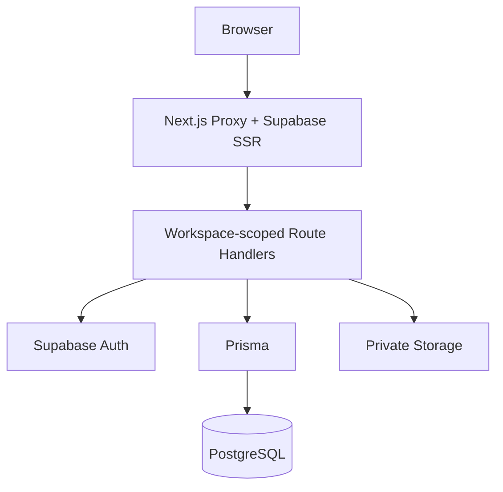
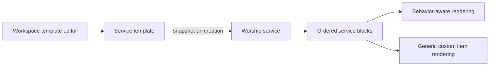

# Worship Flow Architecture

Worship Flow is a modular Next.js monolith for church coordination and worship
production. A `Workspace` is one church organization, and all service and event
data is owned by that workspace.



## Tenant boundary

Workspace pages use `/w/{workspaceSlug}/...`. Workspace APIs use
`/api/workspaces/{workspaceSlug}/...`; the Proxy rewrites these to the existing
feature handlers while carrying the workspace slug in request context. Route
handlers enforce membership and role authorization.

## Identity and access

Supabase Auth owns authentication, sessions, and invitation email delivery.
Application tables own `User`, `WorkspaceMembership`, and
`WorkspaceInvitation`.

- `OWNER` controls the organization and all workspace actions.
- `ADMIN` manages preparation, settings, and membership.
- `MEMBER` retains existing access to legacy modules. Events uses explicit
  View and Create permissions, drawn from workspace Member defaults with
  optional per-person allow/block exceptions.

Settings is canonical at `/w/{workspaceSlug}/settings`. Workspace name,
membership, invitations, service-preparation presets, templates, program block
types, song tags, checklists, and workspace AI integration overrides live there.
Teams remains the service-team assignment surface.

Sermon Captions is a separate workspace module. A booth browser streams audio
to Deepgram with a temporary token issued by a membership-checked route, then
sends recognized text through a server-side Azure Translator adapter. Caption
sessions, their ten most recent viewer lines, and booth connection state are
persisted in Prisma. The public viewer has a per-session URL and receives only
English text. It has no workspace login requirement, so possession of the URL
grants access to that session until its one-hour post-stop retention ends.
Provider keys remain server-side. A future admin-only Settings usage view is
evaluated in the [usage viability note](./planning/sermon-captions-usage-settings-viability.md);
provider balance uses an optional server-only Deepgram billing-read key, while
Azure metered characters are aggregated by workspace and UTC day after each
successful translation. Missing usage headers are counted separately so the
Settings figure can flag incomplete data. The balance is project-wide; the
character count covers only translations made by this application after
tracking began.

Proxy refreshes sessions and performs optimistic redirects. Route handlers are
the authorization boundary and must verify active workspace membership.

## Invitation flow

Owner/Admin creates a pending invitation. Supabase sends the email. The auth
callback verifies the authenticated email against the pending invitation before
creating an active membership transactionally.

## Decisions

The service workflow, settings, media tools, and APIs remain in one Next.js
application. Durable AI workers and billing are deferred until usage requires
them. Prisma remains the application data boundary; the browser does not access
application tables through the Supabase Data API.

`ChurchEvent` and dated `ChurchEventOccurrence` records form the Events module.
They are separate from `WorshipService` and its ordered blocks. Event APIs use
active workspace membership plus exact module/action permission checks for
Member reads and writes. Workspace Member defaults are stored in
`WorkspaceRoleActionDefault`; per-person exceptions are stored in
`WorkspaceActionGrant` with an allow/block value.
Owner/Admin retain administrative access. New event tables have RLS enabled with
no browser Data API policies. The first Events screen is calendar-first and
supports one-time event creation; provider integrations and recurrence behavior
remain later slices.

Templates continue to copy active blocks into stored `WorshipServiceBlock`
rows at creation time, and rendering follows stored block order.

`ServiceTemplateBlock` is the active source of truth for template order, kind,
labels, and defaults. Creating a service copies active ordered blocks and their
submitted values into `WorshipServiceBlock` rows. The current creation handler
sets each copied `fieldDefinition` to an empty fields array; it does not copy
template field definitions. Legacy
`ServiceTemplatePreset.blocks` data is backfilled once and is no longer written
by Settings. Program block versions are a compatibility fallback only; new or
imported templates do not depend on a workspace-wide block-type library.

New workspaces can receive platform-managed starter templates as private,
editable workspace copies. Each church defines its own names, fields, and
order; no starter or template change crosses a workspace boundary. Legacy enum
behavior is retained only as a compatibility mapping, while unknown workspace
keys use `CUSTOM`.

Workspace integration API keys are encrypted server-side and never returned to
the browser. Workspace overrides take precedence over deployment environment
defaults; Supabase, database, storage, and authentication credentials remain
deployment-owned.

### Generalized program blocks

Service templates use a hybrid block model. Built-in `BlockType` values preserve
behavior-aware workflows such as songs, scripture, sermons, and participants;
`CUSTOM` provides a generic worship-service program item with label and details.
Templates are workspace-scoped starting points. New services receive a snapshot
of the template, after which the service owns its block order and block set.



Template changes never rewrite existing services. Service operators may reorder,
rename, add, or remove blocks from an individual service. Arbitrary custom field
builders, nested blocks, and canvas layouts are intentionally deferred until
real service workflows demonstrate the need.

## Song document editing

The formatter lazy-loads a ProseMirror editor from `src/features/song-formatter`.
Ordered tagged sections remain the source of truth; page gaps are non-content
decorations. Extraction responses now include a conversion ID. Metadata-only
`FormatterConversion` records are separate from disposable `FormatterDraft`
content, with one current draft per user/workspace. Session leases and revisions
protect cross-device saves; exit starts a one-hour TTL and scheduled cleanup
removes expired payloads. Browser storage is a bounded unsynced fallback, not
an archive. See [ADR 0003](adr/0003-song-document-editor.md) and
[ADR 0004](adr/0004-temporary-formatter-drafts.md).

## Provisioning

```powershell
npm run provision:workspace -- --name "Example Church" --slug example --owner-email owner@example.com
```

The script is idempotent by workspace slug and sends the first Owner an email
invitation.
