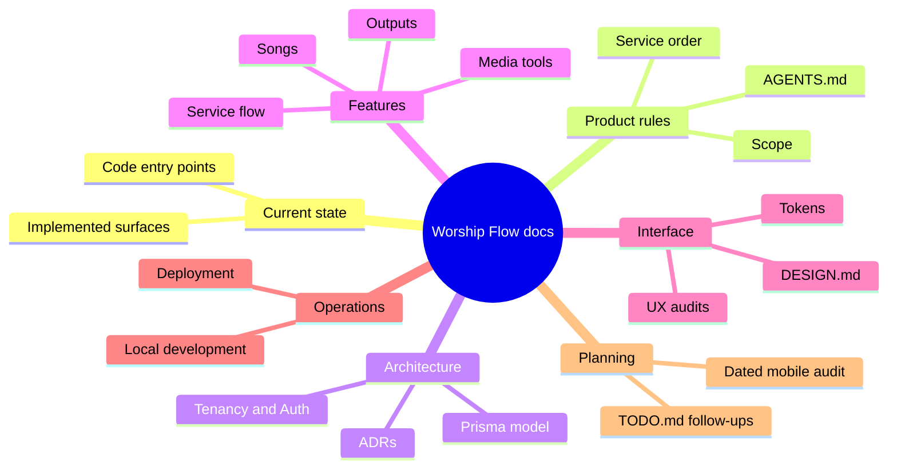

# Document Map

Use this page to choose what to read before changing code. The arrows show
where a question leads; they do not imply every spec is already implemented.

## Read path by decision

| If the decision concerns... | Read first | Then check the implementation |
| --- | --- | --- |
| What exists today | [Current state](./current-state.md) | [Workspace page dispatch](<../src/app/w/[workspaceSlug]/[[...path]]/page.tsx>), [Prisma schema](../prisma/schema.prisma) |
| Product scope or terminology | [AGENTS.md](../AGENTS.md), [current state](./current-state.md) | Relevant feature routes and models |
| Service templates, blocks, or order | [Service flow spec](./specs/service-flow/spec.md), [ADR 0001](./adr/0001-settings-workspace-boundary-and-template-source.md), [ADR 0002](./adr/0002-template-owned-service-fields.md) | [Service creation](../src/app/api/services/route.ts), [service query](../src/lib/service-data.ts), [Prisma schema](../prisma/schema.prisma) |
| Church events and calendar | [Events foundation design](./planning/issue-6/2026-10-24-events-foundation-design.md), [current state](./current-state.md) | [Event API](../src/app/api/events/route.ts), [calendar UI](../src/features/events/events-page-client.tsx), [Prisma schema](../prisma/schema.prisma) |
| Authentication, workspace access, integrations | [Architecture](./architecture.md), [ADR 0001](./adr/0001-settings-workspace-boundary-and-template-source.md) | [Proxy](../src/proxy.ts), [security context](../src/lib/security-context.ts), [settings routes](../src/app/api/settings) |
| Songs and document editing | [Song library](./specs/song-library/spec.md), [formatter](./specs/song-formatter/spec.md), [ADR 0003](./adr/0003-song-document-editor.md), [ADR 0004](./adr/0004-temporary-formatter-drafts.md) | [Formatter feature](../src/features/song-formatter), [song API](../src/app/api/songs/route.ts) |
| Phone, QR, image, or background tools | [Media tools](./specs/media-tools/spec.md), then its tool spec | [Media routes](../src/app/api/media), [PAP feature](../src/features/pap) |
| Jobs, generated files, Sermon Captions, or deployment | [Live outputs](./specs/live-outputs/spec.md), [CaptionKit reference](./specs/live-outputs/captionkit-reference.md), [deployment](./deployment/vercel.md) | [Service job route](<../src/app/api/services/[id]/jobs/route.ts>), [storage adapter](../src/lib/private-output-storage.ts) |
| Sermon Captions provider usage or a Settings usage view | [Usage-view viability research](./planning/sermon-captions-usage-settings-viability.md), [live outputs](./specs/live-outputs/spec.md) | [Translator adapter](../src/features/sermon-captions/caption-providers.ts), [Settings tabs](../src/components/settings-page-client.tsx) |
| Visual or interaction changes | [DESIGN.md](../DESIGN.md), [UX audit guidance](./laws-of-ux-audit.md) | [Tokens](../tokens.css), [global styles](../src/app/globals.css), affected component |
| Local setup | [README](../README.md), [local development](./development/local-dev.md) | [Package scripts](../package.json), [environment example](../.env.example) |
| Future work | [Follow-ups](../TODO.md), [dated mobile audit](./specs/mobile-usability/spec.md), [spec index](./specs/README.md) | Verify against current state before planning |

## Authority and upkeep

For current behavior, trust the checked-in schema, handlers, and UI; this map
is a shortcut to them. `AGENTS.md` sets product and engineering guardrails.
`DESIGN.md` and `tokens.css` set visual rules. ADRs explain accepted decisions;
feature specs define intended behavior, but older specs can lag implementation.
Audits are planning evidence, not proof of a shipped feature.

When a change alters a contract, update the affected spec or ADR and
[current state](./current-state.md). Add a row here only when the reading path
changes. Keep paths narrow so an agent can inspect the relevant slice without
loading every document.
