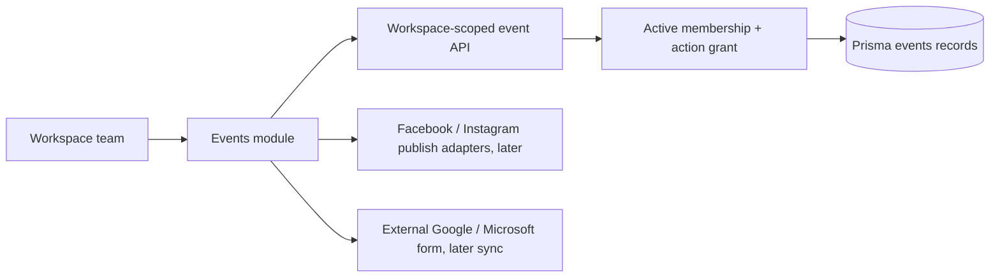
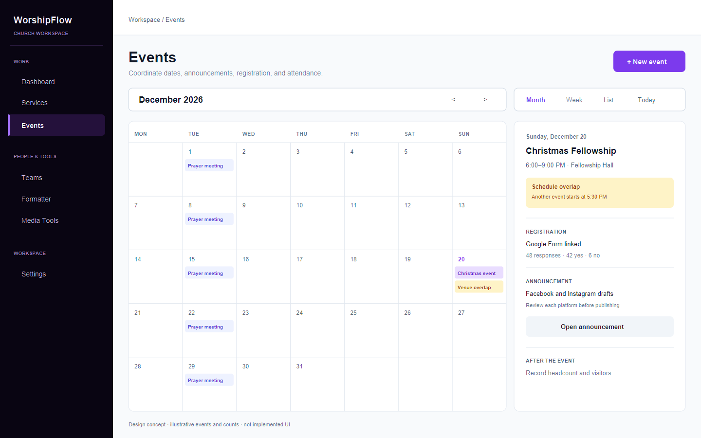

# Events Foundation Design

**Status:** Approved direction; foundation implemented on 2026-10-24. Provider and recurrence workflows remain planned.  
**Source decision:** [Issue #6 direction](./2026-10-24-product-direction-decision.md).  
**Visual draft:** [Events calendar mockup](./events-calendar-mockup.svg).

## Intent

Extend the existing WorshipFlow workspace toward church management, beginning with events and announcements. Organizers need to coordinate dates, prepare Facebook and Instagram posts, optionally link a Google or Microsoft registration form, and record attendance. A worship service remains a distinct `WorshipService`; an event uses its own domain model. The owner wants the database migration first, then an overall visual draft to assess the module before deeper feature implementation.

## Goals

- Support one-time and repeating church events, including individual occurrence changes and cancellations.
- Show scheduling conflicts as advisory warnings; never block saving solely because of a conflict.
- Make registration optional and use external form links. No public WorshipFlow event or RSVP page is needed.
- Keep sign-up details with the form provider. Store or display only response totals and Yes/No counts when a supported integration can supply them.
- Allow a total attendance headcount, with optional visitor names.
- Give individual workspace members action permissions by module. Only Owner/Admin can grant or revoke those permissions.
- Let a permitted publisher review and publish an event announcement without mandatory second-person approval. Start from one draft, then edit Facebook and Instagram versions separately.
- Fit the current light workspace and dark rail design system without crowding worship production.

## Non-goals for this foundation

- Finance, general member directory, volunteer scheduling, pastoral care, and YouTube publishing.
- A public event page, a hosted registration form, or a generic form builder.
- Copying individual registration responses or contact details into WorshipFlow.
- Automatically deciding that two events cannot share a date or venue.
- Replacing or modifying `WorshipService` templates, blocks, or stored service order.

## Approaches considered

| Approach | Trade-off | Decision |
| --- | --- | --- |
| Add Events as a module in the existing workspace | Reuses tenant, identity, navigation, and design system; requires explicit module authorization and clean separation from services. | **Selected by owner.** |
| Build a separate church management app | Keeps the production app untouched but splits sign-in, navigation, data, and operations for the same church team. | Rejected for the first transition. |
| Reuse `WorshipService` for all church activities | Fewer tables initially, but service order, templates, and production behavior would become ambiguous. | Rejected; violates the domain rule. |

## Data foundation: first migration

Create additive Prisma models and one reviewed SQL migration. Existing rows need no conversion or backfill. The migration was applied to the configured hosted Supabase development database on 2026-10-24 after confirming it was the only pending Prisma migration.

| Model | Responsibility and key fields | Boundary |
| --- | --- | --- |
| `ChurchEvent` | `workspaceId`, title, description, venue, timezone, lifecycle status, recurrence kind (`NONE` or `WEEKLY`), and, for weekly events, weekday and local start/end times | Separate from `WorshipService`; workspace owned. |
| `ChurchEventOccurrence` | `eventId`, start/end timestamps, occurrence status (`SCHEDULED` or `CANCELLED`), optional change note, optional registration URL/provider, optional response/Yes/No counts, attendance headcount | One row for a one-time event; repeating events have dated rows so one occurrence can move or cancel. |
| `EventVisitor` | `occurrenceId`, required visitor name, created timestamp | Creating a named visitor record is optional; no automatic import from forms. |
| `EventAnnouncement` | `eventId`, optional `occurrenceId`, shared draft, per-platform Facebook/Instagram content, draft/published state, timestamps | Internal source for team review; no public event page. An event may have no announcement. |
| `WorkspaceActionGrant` | `workspaceId`, `userId`, module, action, `grantedByUserId`, timestamps; unique per person/module/action | Allows individual permissions while retaining existing Owner/Admin roles. Effective access requires an active membership in the same workspace. |

**Migration invariants:** Foreign keys and unique/index rules must keep each record in its workspace. The occurrence start must precede end. Yes/No counts cannot be negative or exceed the response total; attendance cannot be negative. Keep event timezone explicit so weekly local times remain stable across date changes. Define recurrence generation and rescheduling transactions in a later behavior plan, after this schema is approved.

The social account connection model, `EventPublication` records, Google/Microsoft OAuth grants, response sync jobs, and publication adapter contracts need provider-specific design before their migrations. Do not add speculative token columns in this first migration. The first migration can persist event and announcement intent without claiming provider integrations work.

## Access and data flow

Owner/Admin keep administration authority. A member may receive action grants such as `events.view`, `events.create`, `events.edit`, `events.attendance`, `announcements.draft`, and `announcements.publish`. These are product capabilities, not new global role labels. Route handlers must check membership and the exact action. The existing general `MEMBER` write restriction must be revised only through a new explicit authorization path; Proxy remains a session and routing helper, not the authorization boundary. A publisher can publish their own reviewed post.

## Visual direction: second checkpoint

The [mockup](./events-calendar-mockup.svg) shows Events beside Services in the existing dark rail. A **month calendar is the default view**, with List as a secondary control; Week remains a possible later view. Dated event labels and conflict warnings stay in their calendar cells; a focused detail panel shows schedule, optional registration link, and attendance status. A separate announcement composer would use one shared draft and platform tabs for Facebook and Instagram, each with its own editable preview and a clear Publish action visible only to members with that grant. On mobile, use a readable date agenda as the calendar's compact presentation and open details as a full-width panel. Warnings include text and do not rely on color alone.

The mockup contains sample event names solely to communicate layout. It is a planning artifact, not implemented UI or seeded production data. Use existing semantic tokens and current shell components when implementing. No new dashboard metrics, decorative cards, or unrelated navigation modules are needed.

## Delivery order after approval

1. Add the additive Prisma migration; validate the schema, review the SQL, then apply to hosted development after migration-status inspection.
2. Implement the Events route and calendar-first visual shell using actual event records or a truthful empty state in the application.
3. Add event editing, weekly occurrence behavior, warnings, external registration links, attendance, and precise action authorization in independently testable slices.
4. Design and implement social account connections and provider publishing, then Google/Microsoft response summaries, after verifying provider capabilities and permissions.

## Risks and remaining builder choices

- **Provider differences:** [Google Forms](https://developers.google.com/workspace/forms/api/reference/rest) documents create and response APIs. Microsoft's [Forms connector](https://learn.microsoft.com/connectors/microsoftforms/) exposes response triggers/details but no create-form action in its documented operation list; this does not establish every possible Microsoft integration path. A common template can be a guided setup where automation is unavailable. Provider integration belongs in separate issues.
- **Recurrence:** Weekly events need a bounded occurrence generation horizon and a policy for series edits versus single-date exceptions. Choose these in the behavior plan; do not silently rewrite past occurrences.
- **Sensitive data:** Optional visitor names are private workspace data. Define who can view/delete them and how long they are kept before building that UI.
- **Permissions:** Existing global roles and implicit workspace APIs need a security review before member action grants become operational. No grant should let a member alter their own grants.
- **Migration operations:** `npm run dev` points at hosted development data. Use isolated local data for migration validation and separately review any hosted apply.

## Review questions for the owner

1. Does the calendar and detail panel in the mockup feel like the right first appearance?
2. Is the migration scope above right for the first checkpoint, with social and form integration credentials deferred until those providers are designed?
3. Should optional visitor names have a default deletion period, or remain until an authorized organizer deletes them?
