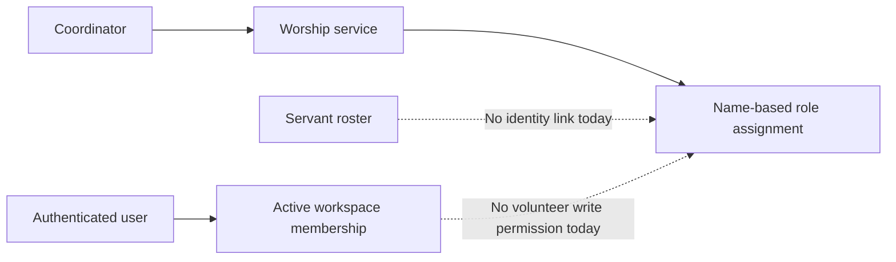

# Issue #6: Volunteer Coordination Discovery Brief

**Status:** Draft discovery input, not an approved implementation spec.  
**Depends on:** [Product direction decision](./2026-10-24-product-direction-decision.md).  
**Proposed slice:** Volunteer availability and assignment confirmation for a specific worship service.

## Purpose and limit

The first proposed feature should help a coordinator fill real worship service roles and see whether each assignment is accepted. It should not become a general staffing calendar, recurring scheduler, messaging system, or church member directory by default. The issue's Phase 1 acceptance criteria are the starting point, not a complete behavior contract.

## Current flow and gaps

The servant roster is workspace-scoped (`Servant`), but has no account link. A service role assignment stores `personName` rather than `servantId`; a block participant also stores a name. The service API validates a block belongs to the active workspace before adding a person. The scoped authorization helper currently treats `MEMBER` as read only. These choices support coordinator entry but cannot identify which logged-in volunteer may answer a request.

## Decisions to settle before an implementation plan

| Question | Why it changes the build | Recommended starting assumption for discussion |
| --- | --- | --- |
| Who counts as a volunteer? | Determines who may see and respond to an assignment. | A roster `Servant` explicitly linked to one active workspace user; never match by name or email automatically. |
| What does “availability for a service date” mean? | A date-wide answer and a role request have different lifetimes. | Record available/unavailable/unknown for one `WorshipService`, with a note only if it is needed for coordination. |
| What is the assignment lifecycle? | Pending, accepted, declined, and substitute requested need consistent transitions. | Request → pending → accepted or declined; replacement creates a separate traceable action and retains the original history. |
| Who can request or assign? | Existing `MEMBER` writes are blocked, while admins can edit broadly. | Coordinators receive an explicit service-assignment capability; volunteers can change only their own availability/response. |
| How are current assignments handled? | Historical rows have names but no stable identity. | Preserve existing display and output values; link only after explicit roster reconciliation. No bulk name matching. |
| What happens without an account? | Some rostered volunteers may never sign in. | Coordinator can record a response with attribution; self-service requires account linkage. |
| Are outbound reminders needed? | This introduces notifications and delivery/consent work. | Exclude outbound messaging from the first slice; surface pending work in the coordinator view. |

These are proposed defaults. The owner should correct them before a design is approved.

## Candidate acceptance checks for the first slice

1. A linked volunteer can mark availability for one service and can see only their own response controls.
2. An authorized coordinator can request a service role and see pending, accepted, and declined assignments together.
3. A linked volunteer can accept or decline only their own pending request; a different workspace member cannot answer it.
4. A coordinator can start a substitution while retaining the original request and its outcome for audit and handoff.
5. An unlinked existing name-only assignment still displays as it did before, without an inferred volunteer identity.
6. Cross-workspace reads and writes fail at the route handler; suspended members cannot access the workflow.
7. Service template copy and stored block order remain unchanged after assignment actions and reload.

## If the owner chooses B

Keep this slice service-specific even under a broader platform direction. Design `ChurchMember`, broader ministry/team records, and delegated permissions in separate issues; specify how each relates to `Servant`, `User`, and `WorkspaceMembership`. Do not expand this first slice into a generic volunteer scheduling engine merely to prepare for those modules.

## Next planning step

After the product direction and the questions above are decided, write an approved feature design and then a task-level implementation plan. The plan should inspect local Next 16 docs before route or data-loading changes, define Prisma migrations and authorization tests, and verify the service-order invariant.
