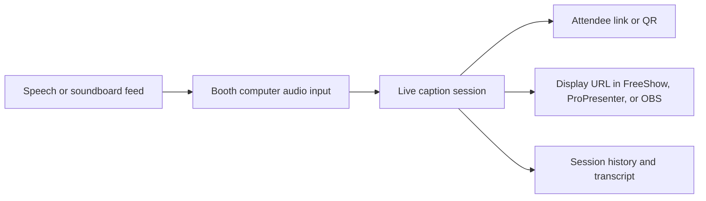

# CaptionKit reference for Sermon Captions

**Research date:** 2026-10-24  
**Scope:** Public CaptionKit documentation and unauthenticated browser assets, compared with the current WorshipFlow implementation. No account was created, no trial was started, and no live audio was sent. CaptionKit's authenticated dashboard and server code were not inspected. Implementation recommendations are our inferences.

## What CaptionKit actually does

CaptionKit is a live service caption and translation system. The booth selects an audio input on a computer, checks levels, chooses the spoken language and translations, then starts a stream. Attendees follow a church link or QR code on a browser or mobile app; the booth can place a styled display URL into presentation or streaming software. Afterward, the account can retrieve session history and transcripts. This is a continuous service session, not a batch job that generates a caption ZIP. [Audio input](https://docs.captionkit.com/en/articles/10171044-setting-up-your-audio-input), [input test](https://docs.captionkit.com/en/articles/10171913-checking-audio-levels), [public links](https://docs.captionkit.com/en/articles/10172622-public-caption-links), [displays](https://docs.captionkit.com/en/articles/10171946-setting-up-displays), [sessions API](https://docs.captionkit.com/en/articles/16414592-sessions).

| Publicly documented behavior | Why it matters for WorshipFlow |
| --- | --- |
| Browser capture supports microphones, audio interfaces and line-in. A sound desk's USB channel routing may need attention; CaptionKit provides a test-input level check. [Input](https://docs.captionkit.com/en/articles/10171044-setting-up-your-audio-input), [levels](https://docs.captionkit.com/en/articles/10171913-checking-audio-levels), [desk routing](https://docs.captionkit.com/en/articles/16729370-connecting-to-your-sound-desk-over-usb). | Input selection and a visible level/preflight state belong before the Start control. A production feed is more reliable than a laptop room microphone. |
| Captions are available in the spoken language; optional live text translation is delayed relative to source captions. CaptionKit lists Tagalog as an input language and Cebuano, Hiligaynon, Ilocano and others as translation languages. [Translation](https://docs.captionkit.com/en/articles/10172148-live-translation), [languages](https://docs.captionkit.com/en/articles/11080883-supported-languages). | Start with the congregation's actual speech and reading languages; distinguish source captions from translations in operator controls and audience output. |
| Attendees can use a web link or QR code without installing an app. The app adds text sizing and audio listening. [Public links](https://docs.captionkit.com/en/articles/10172622-public-caption-links), [accessibility](https://captionkit.com/accessibility), [pricing FAQ](https://captionkit.com/pricing). | A phone viewer is a core output. It should be readable for older members and not require an account. |
| Multiple styled display URLs can be used as transparent overlays or full-screen caption monitors. FreeShow uses a Website overlay, OBS uses a Browser source, and ProPresenter uses Web Fill. [Displays](https://docs.captionkit.com/en/articles/10171946-setting-up-displays), [FreeShow](https://docs.captionkit.com/en/articles/11409062-using-captionkit-in-freeshow), [OBS](https://docs.captionkit.com/en/articles/11562725-using-captionkit-in-obs), [ProPresenter](https://docs.captionkit.com/en/articles/10172499-using-captionkit-in-propresenter). | Treat screen display as a persistent live URL with preview, not as a downloaded file. FreeShow is an especially relevant handoff for WorshipFlow. |
| Boosted and blocked words help with church names and transcription errors; automatic captions can still be wrong. [Keywords](https://docs.captionkit.com/en/articles/10172671-keywords), [accessibility](https://captionkit.com/accessibility). | Include a pre-service vocabulary check and a visible accuracy disclaimer; do not promise verbatim scripture or names. |
| An account API can report profile stream status, list sessions, and download transcript text, JSON with timing, or SRT. A signal API can request start/stop, clear, show/hide, standby, and source-language changes, provided Signals are enabled in the dashboard. [Account API](https://docs.captionkit.com/en/articles/16414680-account), [sessions API](https://docs.captionkit.com/en/articles/16414592-sessions), [signals](https://docs.captionkit.com/en/articles/10172993-signals). | An optional CaptionKit integration could attach a live status and later transcript to a WorshipService. API keys stay server-side. The signal docs describe remote control of an open dashboard or app; do not assume a server call alone captures booth audio. |
| Audio translation is an additional listener mode, with a few seconds of delay and language/plan limits. [Audio translations](https://docs.captionkit.com/en/articles/17305065-audio-translations), [pricing](https://captionkit.com/pricing). | Keep text captions usable independently; audio translation can be a later decision. |

## Public artifact inspection with REA

On 2026-10-24, the unauthenticated `https://app.captionkit.com/` page served an [app bundle](https://app.captionkit.com/assets/index-cYpZIHL8.js) (SHA-256 `2967DC264CC41C6C78DB187B48BD6503B5F7A11DB60C0827DDD0467C57E92E5E`) and an [audio worklet](https://app.captionkit.com/assets/worklet-DFuLj59Z.js) (SHA-256 `C65E9F7440463045E5E34CEB76F8EE7D2B5DE07C01A19D6BDCD4961885454C59`). These are publicly shipped files, not private source. They can change independently of this report.

REA's CLI statically analyzed the worklet and produced Evidence `ev_4dda4c33e7d33a2a0de1b687ddc726bf2570c33e0c3afe843614a71f986d5d54`: one selected JavaScript file was parsed without a parse failure. The larger minified app bundle produced partial Evidence `ev_abe59cc7b544ce68563653702d83d25ef8e97acef51995d114b5e8cfd3ea7ba4`; its worker exhausted the default roughly 1 GiB heap before parsing that file. The app-bundle observations below are narrow manual static reads of the downloaded bytes, not claims that REA traced its complete graph or that the code ran during this investigation.

| Static observation | Practical reading and limit |
| --- | --- |
| The app bundle calls browser `getUserMedia` for audio, selects an input device, and falls back from an exact device ID to a preferred ID and then the system default when a device is missing. [Public bundle](https://app.captionkit.com/assets/index-cYpZIHL8.js). | A booth workflow needs an explicit selected-input check and a visible fallback warning. Static code does not prove which fallback appears in the current dashboard. |
| The app bundle loads an `AudioWorkletNode`, converts worklet samples to 16-bit audio, collects roughly 100 ms chunks, and has a WebSocket path that can send audio blobs. [Public bundle](https://app.captionkit.com/assets/index-cYpZIHL8.js), [worklet](https://app.captionkit.com/assets/worklet-DFuLj59Z.js). | The browser is an active audio capture client. An API key or server-side start signal alone cannot substitute for booth audio input. Exact live transport behavior was not observed. |
| The worklet measures each input channel, chooses a stable reference, gates much quieter channels, accounts for polarity, and crossfades when the mix changes. [Worklet](https://app.captionkit.com/assets/worklet-DFuLj59Z.js). | Channel routing matters: a sound-desk feed on inaccessible USB channels can still fail before this processing. The [desk setup guide](https://docs.captionkit.com/en/articles/16729370-connecting-to-your-sound-desk-over-usb) says browsers commonly see only the first two channels. |
| The app bundle has local state for interim and complete caption items, replacing an item with the same start time when it changes. It also includes reconnect and session-conflict handling. [Public bundle](https://app.captionkit.com/assets/index-cYpZIHL8.js). | A WorshipFlow preview would need to distinguish changing interim text from final text and handle reconnection. These private client structures do not establish a supported external live-caption API. |
| CaptionKit's [accessibility statement](https://captionkit.com/accessibility) says web attendee pages support browser zoom and light/dark themes, but do not yet announce each new caption to screen readers or offer an in-page text-size control. | If older members or screen-reader users are a primary audience, test the actual attendee flow before treating it as fully accessible. This is the vendor's published limitation, not a result of our runtime testing. |

The public files support a more precise flow: **booth audio device → browser audio worklet → live session transport → caption and translation outputs**. The public account API separately exposes status and post-session transcripts; it is not evidence of a supported raw live-caption subscription. [Account API](https://docs.captionkit.com/en/articles/16414680-account), [sessions API](https://docs.captionkit.com/en/articles/16414592-sessions).

## What WorshipFlow currently has

- The `/w/{workspaceSlug}/automation` route renders the shared service builder's automation panel, labelled **Sermon Captions** in the rail. It asks for a service, a job type, and optional JSON. [`page.tsx`](<../../../src/app/w/[workspaceSlug]/[[...path]]/page.tsx>), [`workspace-shell.tsx`](../../../src/components/workspace-shell.tsx), [`service-builder-client.tsx`](../../../src/components/service-builder-client.tsx).
- `CAPTION_GENERATE` is a persisted `AutomationJob`, but the handler waits briefly and writes JSON containing `captionsCount: 12` and a resolution to a file named like a ZIP. It does not capture audio, recognize speech, stream live captions, translate, or create an SRT transcript. [`jobs/route.ts`](<../../../src/app/api/services/[id]/jobs/route.ts>), [`schema.prisma`](../../../prisma/schema.prisma).
- The job endpoint validates a job type, checks the service's workspace and stores `AutomationJob` and `GeneratedOutput` rows. The legacy workspace security helper currently blocks Member writes to these service APIs. [`validation.ts`](../../../src/lib/validation.ts), [`security-context.ts`](../../../src/lib/security-context.ts), [`jobs/route.ts`](<../../../src/app/api/services/[id]/jobs/route.ts>).

## Design implication

The current **Output queue** is a useful history and export pattern, but it is not the right primary interface for live sermon captions. A fitting Sermon Captions screen would be organized around **Prepare → Live → Review** for one worship service:

1. **Prepare:** associate a `WorshipService`, select a booth input and source language, verify audio levels, choose caption/translation outputs, test the display, review vocabulary and share the audience link or QR.
2. **Live:** start/stop a session, show connection and audio status, expose a readable preview, and offer clear/standby/display visibility controls. If a provider is used, distinguish provider stream state from local audio capture state.
3. **Review:** attach the completed session and transcript/SRT to the service, show retrieval failures clearly, and let an authorized operator download or correct archival text. A transcript should not be presented as certified or error-free.

Suggested initial requirements, subject to team approval:

- **SC-01:** When an operator prepares a service, WorshipFlow shall show whether a booth audio source is receiving signal before Start is enabled.
- **SC-02:** While a caption session is live, WorshipFlow shall show the source language, live state and a caption preview associated with that service.
- **SC-03:** When a service's caption session ends, WorshipFlow shall record the session identifier and retrieve a timed transcript where the selected provider supports it.
- **SC-04:** Where an attendee link is available, WorshipFlow shall provide a QR/share handoff without requiring an attendee account.
- **SC-05:** Only a Member with an explicit Sermon Captions control action, or an Admin/Owner, shall start or stop a session. Viewer access and configuration access should be separate actions.

These are **proposed WorshipFlow requirements**, not claims about currently shipped behavior.

## Options to decide

| Path | Benefits | Costs and limits |
| --- | --- | --- |
| **Integrate CaptionKit first** | Caption engine, translations, audience pages, display links, and SRT already exist. A WorshipFlow service can link to the provider session and transcript. | Requires a paid provider plan for continued use, account API key handling, live internet access, and confirmation of API behavior with an actual account. WorshipFlow would not own the capture or audience experience. |
| **Build WorshipFlow live captions** | Full control over service, permissions, UI and local-first direction. | Requires real-time audio capture, speech recognition, broadcast transport, audience page, captions display, failure recovery, transcript timing, privacy and operating cost. The current mock job is not a shortcut to these pieces. |
| **Reference workflow only, manual handoff** | Fastest way to learn whether the church needs captions: run CaptionKit at the booth and save its link or transcript with a service. | Limited unified control and history in WorshipFlow; operators switch tools. |

**Recommendation:** Use CaptionKit as a workflow benchmark while the team decides whether it is an integration or merely a reference. Defer any trial or live-service test; the user explicitly chose not to use CaptionKit's trial yet. A future provider evaluation can be planned separately. This is an inference from the documented workflow and current code, not a vendor claim.

## Unverified points

- No authenticated CaptionKit dashboard or live session was tested. Public docs and static client code establish advertised or candidate behavior, but not actual latency, audio quality in the church, or failure behavior on its network. The app bundle's full REA parse remains incomplete because the bounded worker ran out of heap.
- The examined docs show signals, status and post-session transcripts; they do not establish a supported API for subscribing to raw live caption events. Confirm this with CaptionKit before promising a native WorshipFlow live preview.
- Older API examples use `api.captionkit.io`; newer account/session examples use `api.captionkit.com`. Verify the canonical host and API contract before integration. [Signals](https://docs.captionkit.com/en/articles/10172993-signals), [sessions](https://docs.captionkit.com/en/articles/16414592-sessions).
- Decide whether Sermon Captions is intended for live accessibility, post-service subtitle files, or both. The current `CAPTION_GENERATE` name suggests an offline package, while CaptionKit is primarily a live session product.
- Set a transcript retention policy and review provider data handling before importing sermon speech or identifiable visitor speech. [CaptionKit privacy policy](https://captionkit.com/privacy).
